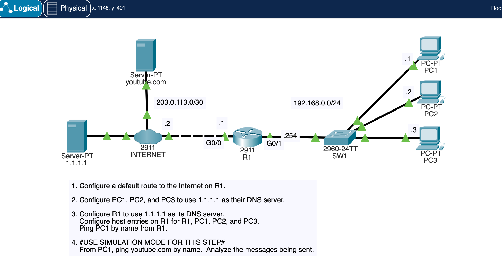

# DNS and Default Routing

Cisco Packet Tracer lab completed while following Jeremy's CCNA course.

## What I Configured

### 1. Default Route
- Configured a default static route on R1 to provide a path to the Internet.

### 2. DNS Configuration
- Configured PC1, PC2, and PC3 to use `1.1.1.1` as their DNS server.
- Configured R1 to use `1.1.1.1` for DNS resolution.
- Added local host entries on R1 for R1, PC1, PC2, and PC3.
- Tested name resolution by pinging PC1 from R1 using its hostname.

### 3. DNS Resolution in Simulation Mode
- Used Simulation Mode to ping `youtube.com` from PC1.
- Observed the messages exchanged during the process.
- Examined how DNS queries resolve a hostname into an IP address before ICMP packets are sent.

## Screenshots

### Network Topology

## What I Learned

- How a default route forwards traffic to destinations not covered by more specific routes.
- How to configure DNS servers on PCs and routers.
- The difference between local host entries and DNS resolution.
- How DNS translates domain names into IP addresses.
- How to use Simulation Mode to inspect DNS and ICMP traffic in Packet Tracer.

This lab helped me understand how DNS and routing work together when accessing services by domain name.